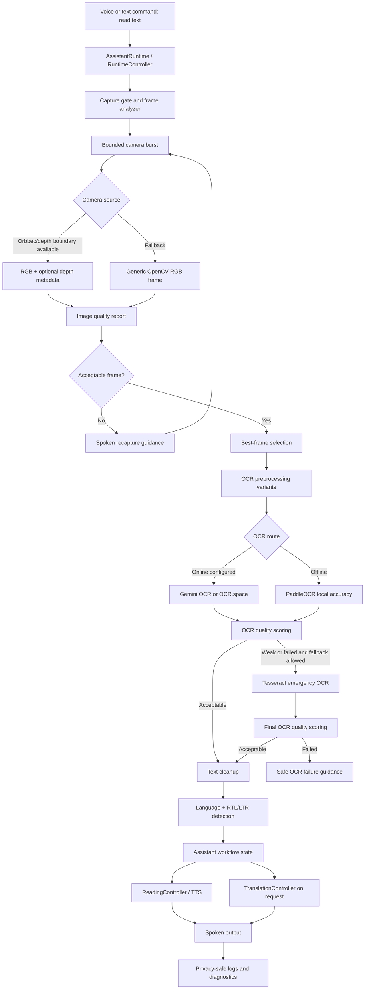
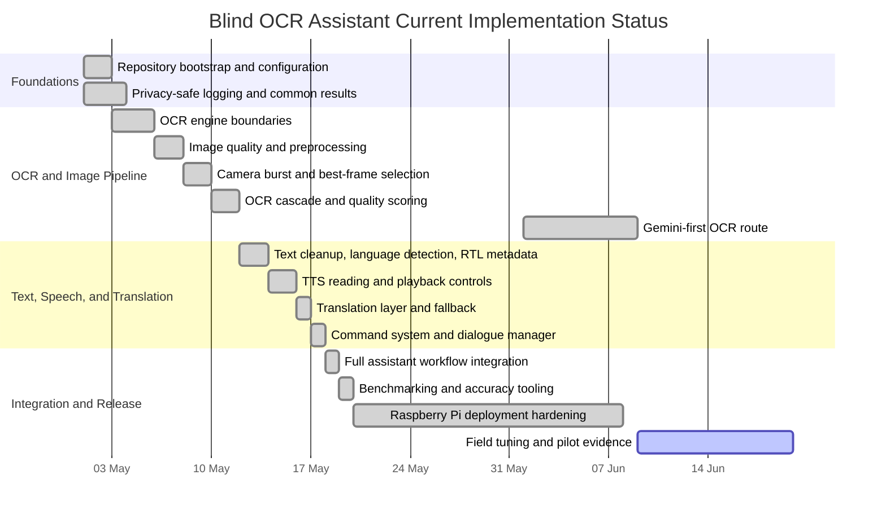
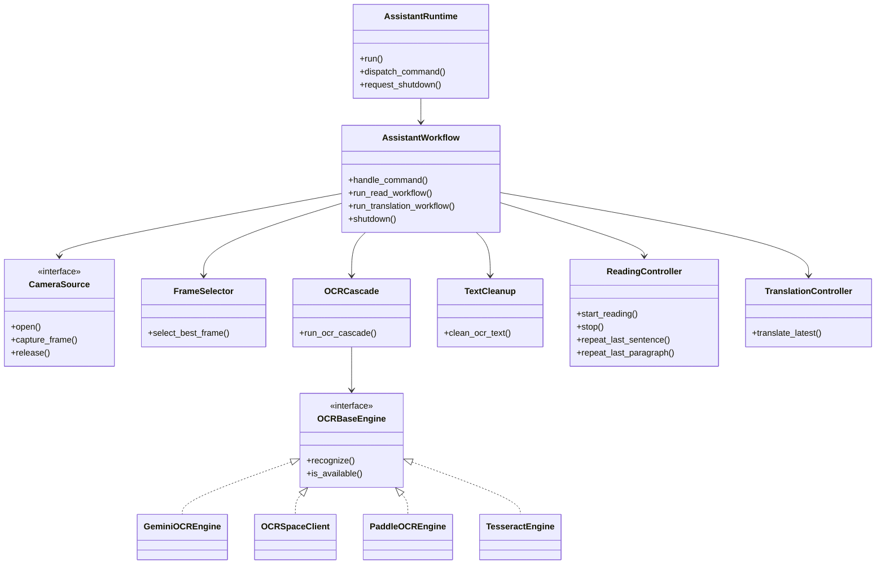

# OCR Documentation Change List

This Markdown file lists the OCR documentation updates that should be applied to the main graduation project document. It does not modify the DOCX directly. It shows each old OCR-related section and the proposed replacement text based on the current `D:\EGB_FUNCTIONS\blind_ocr_assistant` project.

## Scope

- Target project: `D:\EGB_FUNCTIONS\blind_ocr_assistant`
- Main document topic: OCR / Optical Character Recognition module
- Current implementation assumption: the OCR workflow is connected through the current assistant runtime, OCR cascade, camera/frame-selection pipeline, cleanup, TTS, translation, command system, and deployment diagnostics.

## 1. Abstract / Project Overview OCR Paragraph

### Old

```text
Moreover, the OCR function converts printed text into audible speech, allowing users to read signs, menus, and documents independently.
```

### New

```text
Moreover, the OCR function is implemented as a complete assistive reading workflow. It captures camera frames, selects the clearest frame, checks image quality, runs a Gemini-first or online/local OCR cascade, cleans Arabic and English text, detects language and direction, and sends readable output to speech and translation controllers. This allows users to read signs, menus, labels, receipts, books, and documents through voice-first interaction with local fallback support.
```

## 2. Project Purpose / Daily Independence Paragraph

### Old

```text
Supporting the objective of daily task independence, the system integrates OCR to convert printed text into speech and a money detection module to recognize currency denominations and perform basic arithmetic operations. These functions enable users to access written information and manage financial transactions independently.
```

### New

```text
Supporting the objective of daily task independence, the system integrates a full OCR reading assistant that converts printed Arabic, English, and mixed text into spoken output, with optional translation between Arabic and English. The OCR route includes camera capture, best-frame selection, image-quality guidance, OCR fallback, text cleanup, reading control, and privacy-safe logging. Together with money detection, this enables users to access written information and manage daily tasks independently.
```

## 3. Functional Objective Section: OCR

### Old

```text
The OCR function allows independent access to written information by converting printed text into audible speech. This includes reading signs, menus, labels, and documents. The function ensures that users can obtain textual information autonomously without requiring external assistance.
```

### New

```text
The OCR function allows independent access to written information by converting printed Arabic, English, and mixed text into audible speech. In the current implementation, the module captures a bounded burst of camera frames, selects the best readable frame, applies OCR-specific preprocessing, runs a quality-scored OCR cascade, cleans and normalizes the extracted text, and passes the final clean text to reading and translation controllers. It supports online-first operation when configured and offline fallback through local OCR engines.
```

## 4. Success Criteria Section: OCR

### Old

```text
OCR is considered successful when printed text is consistently and accurately converted into audible speech. This includes reading menus, signs, labels, and documents. Success criteria include clarity of audio output, minimal recognition errors, and usability across various fonts and sizes, enabling independent access to written information.
```

### New

```text
OCR is considered successful when the assistant can guide the user to a readable frame, select the clearest image, extract Arabic and English printed text through the OCR cascade, reject or retry weak results safely, clean the text without damaging mixed-language content, and read or translate the result through the voice workflow. Success criteria include OCR quality score acceptance, fallback correctness, privacy-safe logs, bounded latency, clear spoken guidance, and stable operation on Raspberry Pi-targeted hardware.
```

## 5. Methodology / Simulation OCR Paragraph

### Old

```text
OCR and Multilingual Text Processing:
Printed text recognition for Arabic and English, tested across fonts, sizes, and lighting conditions.
Optional text translation and text-to-speech output verified in simulation.
```

### New

```text
OCR and Multilingual Text Processing:
The OCR workflow supports Arabic, English, and mixed printed text using camera capture, image-quality checks, preprocessing variants, OCR cascade routing, text cleanup, RTL/LTR direction metadata, reading segmentation, TTS playback, and Arabic-English translation. Testing covers OCR engines, fallback routes, cleanup quality, translation handoff, TTS reading, command routing, privacy-safe logging, benchmark fixtures, and Raspberry Pi deployment diagnostics.
```

## 6. Tools and Technology Section

### Old

```text
Libraries: OpenCV, Tesseract OCR, pytesseract, NumPy, deep-translator, pyttsx3
```

### New

```text
Libraries and technologies: Python 3.10+, OpenCV, NumPy, SpeechRecognition/sounddevice where available, Vosk for fixed command fallback, Edge TTS/local eSpeak NG/Windows SAPI for speech output, Gemini OCR as the preferred online OCR route when configured, OCR.space as an online OCR option, PaddleOCR as local accuracy fallback, Tesseract ara+eng as emergency fallback, deterministic text cleanup/RTL utilities, online translation stack with Gemini/Google/MyMemory/LibreTranslate options, Argos Translate fallback, pytest, ruff, benchmark tooling, and Raspberry Pi deployment diagnostics.
```

## 7. System Architecture / Module D Summary

### Old

```text
7.4Module D: OCR (Optical Character Recognition)
The OCR module converts printed text from documents, signs, and labels into audible speech, allowing independent access to information.
```

### New

```text
7.4 Module D: OCR (Optical Character Recognition)
The OCR module is a connected assistive reading pipeline. It receives selected camera frames from the capture/frame-selection layer, validates image quality, prepares OCR-specific image variants, runs Gemini/OCR.space/PaddleOCR/Tesseract through a controlled cascade, assesses OCR quality, cleans Arabic and English text, preserves latest in-memory workflow state, and sends readable output to TTS and translation controllers. It is integrated with the voice command workflow and can operate in online-first, offline, and high-accuracy modes.
```

## 8. Full Section Replacement: 4.6 OCR

Replace the old `4.6 OCR` section with the following updated section.

### Old

```text
4.6 OCR
By Samir Hawash
4.6.1Responsible Scope:
Responsible for designing, implementing, and optimizing the OCR pipeline including image preprocessing, text extraction, noise filtering, text stability handling, and preparing outputs for speech and translation modules
4.6.2Module Overview
The OCR module is a core component of the smart glasses system. Its primary responsibility is to capture visual text from the surrounding environment through the camera, process the image intelligently, extract readable text accurately, and deliver it to the speech and translation modules. This module enables visually impaired users to understand their environment by converting printed text into audible speech in real time. It integrates tightly with the preprocessing module, TTS engine, and translation services to deliver a seamless assistive experience. Without this module, the smart glasses lose their primary assistive functionality: perceiving and understanding textual content in the real world.
4.6.3 Module Objectives
Accurately detect and extract readable Arabic and English text from live camera frames.
Reduce noisy or duplicated OCR results using intelligent filtering and similarity detection.
Support real-time interaction by detecting only stable frames to improve reliability.
Provide structured output that can be consumed by both TTS and translation modules
4.6.4Functional Requirements
Capture real-time frames from the camera stream.
Enhance image quality dynamically based on lighting conditions.
Extract Arabic and English text using Tesseract OCR engine.
Filter out low-quality or meaningless OCR outputs.
Detect and avoid repeating similar text using similarity matching algorithms.
Aggregate detected lines into meaningful paragraphs before output.
Support session reset when starting a new reading cycle.
Provide structured outputs suitable for downstream processing (TTS / Translation).
4.6.5 Non-Functional Requirements
Accuracy: Filters short and noisy text and avoids duplicated readings.
Real-Time Constraints: Uses frame stability detection and multithreading to ensure responsiveness.
Performance: Lightweight processing pipeline optimized for wearable hardware.
Hardware Limitations: Designed to run efficiently on low-power devices.
4.6.6Module Architecture
Input: Live camera frames.
Processing: Frame stability detection → adaptive preprocessing → OCR → filtering → paragraph aggregation.
Output: Clean readable text sent to Text-to-Speech and Translation modules.
4.6.7 Tools & Technologies
Programming Language: Python
Libraries: OpenCV, Tesseract OCR, pytesseract, NumPy, deep-translator, pyttsx3
Hardware: Webcam (simulating smart glasses camera), wearable-compatible architecture
4.6.8Testing Strategy
Unit testing for preprocessing and OCR accuracy.
Integration testing for OCR with TTS and translation.
Real-time testing under different lighting and movement conditions.
Metrics include accuracy and latency.
Figure25.66: Flowchart For OCR
4.6.9Implementation Plan
Week 1: Camera and preprocessing development.
Week 2: OCR integration and filtering.
Week 3: System integration and optimization.
Figure26.68: Gantt Chart For OCR
4.6.10Integration with System
Receives camera frames and outputs extracted text to speech and translation services. Depends on preprocessing, TTS engine, and translation modules.
4.6.11Expected Results System
can accurately read Arabic and English printed text.
Speech output is understandable and natural.
System avoids repeated readings and operates in real time.
4.6.12Challenges & Future Work
Challenges include motion blur, lighting variation, and Arabic OCR limitations. Future work includes deep learning OCR, layout understanding, handwriting support, and enhanced neural TTS.
```

### New

```text
4.6 OCR
By Samir Hawash

4.6.1 Responsible Scope
The OCR module is responsible for the full assistive reading pipeline: camera-frame intake, image-quality validation, OCR-specific preprocessing, OCR engine routing, OCR quality scoring, text cleanup, language and direction detection, reading handoff, translation handoff, privacy-safe metadata, benchmark evidence, and Raspberry Pi deployment readiness.

4.6.2 Module Overview
The OCR module is a core component of the smart glasses system. In the current implementation, it is not limited to a single OCR engine. It works as a connected workflow inside the Blind OCR Assistant runtime. The user can trigger reading through voice or text commands; the assistant captures a bounded burst of frames, selects the clearest frame, verifies whether the image is ready for OCR, runs an OCR cascade, cleans the extracted text, detects Arabic/English/mixed language, and sends the clean text to TTS or translation. The module supports online-first operation when configured and offline fallback through local OCR engines.

4.6.3 Current Integrated Pipeline
The implemented OCR flow is:
Voice/text command -> assistant workflow -> camera burst -> best-frame selection -> image quality gate -> preprocessing variants -> OCR cascade -> OCR quality scoring -> text cleanup and RTL/LTR metadata -> reading controller -> optional translation controller -> privacy-safe logs and runtime state update.

The camera layer prefers the target depth-camera boundary when available and can fall back to generic OpenCV RGB capture. Depth is treated as an enhancement, not a hard dependency. The default capture policy selects from a bounded burst of frames instead of running OCR on every video frame.

The OCR cascade supports three main route types:
Normal route: preferred online OCR engine -> local accuracy OCR -> emergency OCR.
Offline route: local accuracy OCR -> emergency OCR.
High Accuracy route: compare available online and local accuracy candidates, then use emergency OCR only when compared candidates fail or remain weak.

The current online OCR preference is Gemini OCR when `ASSISTANT_GEMINI_OCR_ENABLED=true` and `GEMINI_API_KEY` is configured. OCR.space remains available as an online OCR option. PaddleOCR is the local accuracy fallback. Tesseract ara+eng is the emergency fallback.

4.6.4 Module Objectives
Objective 1: Capture readable printed text from Arabic, English, and mixed-language scenes using bounded camera capture and best-frame selection.
Objective 2: Prevent bad images from reaching OCR by using image quality checks, text-presence estimation, depth/distance guidance when available, and spoken recapture guidance.
Objective 3: Extract text using a quality-scored OCR cascade rather than a single hardcoded OCR engine.
Objective 4: Clean OCR output conservatively while preserving Arabic, English, mixed text, numbers, punctuation, prices, dates, and paragraph structure.
Objective 5: Provide clean text to the reading and translation controllers without requiring visual confirmation.
Objective 6: Preserve privacy by excluding image payloads, raw OCR text, cleaned text, translated text, secrets, and private debug paths from default logs and deployment artifacts.

4.6.5 Functional Requirements
The module shall capture a bounded frame burst from the configured camera source.
The module shall select the best frame using image quality, stability, and optional distance information.
The module shall reject or guide recapture when no acceptable frame is available.
The module shall create OCR-specific preprocessing variants before OCR execution.
The module shall run the OCR cascade with online, offline, and high-accuracy modes.
The module shall prefer Gemini OCR when configured, then local fallback when online OCR is unavailable, weak, timed out, or disabled.
The module shall use PaddleOCR as local accuracy fallback and Tesseract ara+eng as emergency fallback.
The module shall score OCR output and reject empty, very short, symbol-heavy, fragmented, or low-quality text.
The module shall clean OCR text, preserve raw text separately in volatile workflow state, and detect Arabic, English, mixed, or unknown language.
The module shall hand clean text to TTS reading and translation controllers.
The module shall keep latest successful clean text in memory for translation and repeat workflows.
The module shall clear volatile text-bearing state on shutdown.

4.6.6 Non-Functional Requirements
Accuracy: OCR quality must be measured using deterministic scoring and fallback decisions. Weak results should trigger fallback instead of being read directly.
Responsiveness: Camera capture is bounded, OCR engines are attempted at most once per cascade request by default, and heavy OCR models are lazy-loaded.
Accessibility: Every major state must have non-visual guidance, including camera failure, poor image quality, OCR failure, reading start, translation failure, and offline recovery.
Privacy: Default logs and diagnostics must contain metadata only. Raw images, OCR text, clean text, translated text, prompts, secrets, and debug paths are excluded unless explicit debug/sensitive logging is enabled.
Offline resilience: The assistant must still support local OCR fallback when online OCR is unavailable or disabled.
Raspberry Pi awareness: Startup checks remain lightweight, service startup is optional, logs are bounded, and full diagnostics are explicit maintainer actions.

4.6.7 Module Architecture
Input: camera frames from Orbbec-depth boundary or generic OpenCV RGB fallback, voice/text commands, OCR configuration, online/offline status, and latest workflow state.
Processing: command routing -> capture gate -> frame analyzer -> capture burst -> best-frame selection -> image-quality report -> preprocessing variants -> OCR cascade -> OCR quality report -> text cleanup -> language/direction detection -> reading or translation handoff.
Output: spoken reading, spoken guidance, translated reading when requested, latest in-memory clean text, selected OCR engine metadata, fallback/offline/high-accuracy flags, benchmark evidence, and privacy-safe diagnostic summaries.

Main files:
main.py
config.py
modules/assistant/runtime.py
modules/assistant/workflow.py
modules/assistant/reading_controller.py
modules/assistant/translation_controller.py
modules/camera/orbbec_camera.py
modules/camera/frame_selector.py
modules/image_processing/quality_checker.py
modules/image_processing/preprocessing.py
modules/ocr/gemini_ocr_engine.py
modules/ocr/ocr_space_client.py
modules/ocr/paddle_ocr_engine.py
modules/ocr/tesseract_engine.py
modules/ocr/ocr_cascade.py
modules/ocr/ocr_quality.py
modules/text/cleanup.py
modules/text/language_detector.py
modules/text/rtl_fixer.py
modules/voice/command_parser.py
modules/voice/tts_engine.py
modules/deployment/diagnostics.py
modules/benchmark/runner.py

4.6.8 Tools and Technologies
Programming language: Python 3.10+.
Camera and image processing: OpenCV, NumPy, Orbbec adapter boundary, generic RGB fallback, quality checker, preprocessing variants, frame selector, and optional depth analysis.
OCR engines: Gemini OCR as preferred online OCR when configured, OCR.space as online OCR option, PaddleOCR as local accuracy fallback, and Tesseract ara+eng as emergency fallback.
Text layer: deterministic cleanup, Arabic/English/mixed language detection, RTL/LTR direction metadata, and sentence/paragraph segmentation.
Speech and commands: fixed Arabic/English command parser, Vosk fallback command recognizer, Edge TTS/local eSpeak NG/Windows SAPI speech output, reading controls, and spoken guidance.
Translation: Gemini/Google/MyMemory/LibreTranslate online routes where configured and Argos Translate offline fallback.
Validation: pytest unit/integration tests, benchmark fixtures and result writer, ruff, Raspberry Pi deployment diagnostics, optional service template, and troubleshooting docs.

4.6.9 Testing Strategy
Unit tests cover OCR engine contracts, Gemini OCR parsing and privacy behavior, OCR cascade routing, OCR quality scoring, image quality checks, preprocessing, frame selection, text cleanup, language detection, RTL handling, reading controller, translation controller, command parser, runtime controller, benchmark tooling, and deployment readiness models.
Integration tests cover full read workflow, full translation workflow, deployment diagnostics, optional live OCR, optional camera validation, benchmark workflow, and privacy-safe failure paths.
Manual tests cover Orbbec/RGB camera capture, microphone input, TTS output, no-internet startup, local OCR fallback, repeated start/stop behavior, and Raspberry Pi service operation.
Metrics include OCR quality score, selected engine, fallback use, offline route use, high-accuracy route use, duration, benchmark text similarity, failure category, and readiness status.

4.6.10 Implementation Status
The OCR pipeline is currently implemented and connected through the assistant workflow. The system includes camera capture, best-frame selection, image-quality guidance, OCR cascade, text cleanup, reading, translation, voice/text command routing, benchmark tooling, privacy-safe logging, and Raspberry Pi deployment diagnostics.

Completed routes include:
Gemini OCR online route when configured.
OCR.space online route when configured.
PaddleOCR local accuracy fallback.
Tesseract ara+eng emergency fallback.
Offline OCR route.
High Accuracy OCR route.
Arabic/English/mixed text cleanup.
TTS reading and reading controls.
Translation from latest clean text.
Lightweight startup diagnostics and full deployment diagnostics.

Remaining work is mainly field tuning: Raspberry Pi hardware validation, camera placement calibration, OCR threshold tuning with real-world samples, Vosk model provisioning, audio device selection, and pilot evidence collection.

4.6.11 Integration with System
The OCR module receives selected frames from the camera workflow and returns structured OCR results to assistant state, reading, and translation controllers. It is triggered by voice/text commands such as read text, translate to Arabic, translate to English, repeat, stop, continue, status, capture now, and help. The module also participates in runtime diagnostics, benchmark reporting, and deployment readiness checks.

4.6.12 Expected Results
The system can read Arabic, English, and mixed printed text through a voice-first workflow.
The system can guide the user when the frame is too dark, blurry, unstable, too close, too far, or unlikely to contain text.
The system can fall back from online OCR to local OCR without crashing.
The system can translate the latest clean OCR text between Arabic and English.
The system can read clean text aloud and support stop, continue, repeat sentence, and repeat paragraph commands.
The system can run privacy-safe diagnostics without storing private images or text by default.

4.6.13 Challenges and Future Work
Remaining challenges include real Raspberry Pi performance tuning, low-light image quality, motion blur, difficult Arabic fonts, mixed-layout documents, API/network variability, local model size, microphone reliability, and OCR accuracy on far or angled text. Future work includes larger real-world benchmark coverage, improved frame guidance, hardware-calibrated capture thresholds, stronger layout understanding, handwriting support, more natural local TTS, and expanded field validation.
```

## 9. Figure Updates

The document currently contains old OCR diagrams/captions:

- `Figure25.66: Flowchart For OCR`
- `Figure26.68` / `Figure26.67: Gantt Chart For OCR`

These should be replaced because the old diagrams describe a simple Tesseract-centered pipeline and a three-week future plan. The current project has a connected runtime, OCR cascade, Gemini-first route, local fallback, text cleanup, TTS, translation, benchmark, and deployment diagnostics.

### 9.1 Figure25.66: Flowchart For OCR

#### Old figure meaning

```text
Live camera frames -> frame stability -> adaptive preprocessing -> Tesseract OCR -> filtering -> paragraph aggregation -> TTS / translation
```

#### New figure content



#### New caption

```text
Figure25.66: Updated OCR workflow showing command routing, bounded camera capture, best-frame selection, image-quality gate, Gemini/OCR.space/PaddleOCR/Tesseract cascade, text cleanup, reading, translation, and privacy-safe diagnostics.
```

### 9.2 Figure26.68: Gantt Chart For OCR

#### Old figure meaning

```text
Week 1: Camera and preprocessing development.
Week 2: OCR integration and filtering.
Week 3: System integration and optimization.
```

#### New figure content



#### New caption

```text
Figure26.68: Updated OCR implementation status timeline showing completed OCR engines, camera/frame selection, cascade routing, text cleanup, TTS, translation, command workflow, benchmarking, and Raspberry Pi deployment hardening, with remaining work focused on field tuning and pilot evidence.
```

## 10. Class Diagram / System Flow Diagram Notes

If the document class diagram still shows OCR as one simple block or only as `camera -> preprocessing -> Tesseract -> TTS`, it should be updated.

### Old diagram meaning

```text
OCR Module
- Camera frame
- Preprocessing
- Tesseract OCR
- Text filtering
- TTS / translation output
```

### New diagram meaning

```text
AssistantRuntime / AssistantWorkflow
- RuntimeController
- CaptureGate
- FrameAnalyzer
- CameraSource
- BestFrameSelectionResult
- ImageQualityReport
- Preprocessing variants
- OCRCascadeRequest
- OCRCascadeResult
- GeminiOCREngine
- OCRSpaceClient
- PaddleOCREngine
- TesseractEngine
- TextCleanupResult
- LanguageDetectionResult
- ReadingController
- TranslationController
- BenchmarkRunner
- DeploymentDiagnostics
```

### New class diagram content



## 11. Evaluation / Results OCR Paragraphs

### Old

```text
The OCR module was evaluated for its ability to extract printed Arabic and English text from real-world scenes. The system achieved an average accuracy of approximately 80% to 85%.
```

### New

```text
The OCR module is evaluated through unit tests, integration tests, optional live OCR tests, benchmark fixtures, and deployment diagnostics. Instead of relying only on a single average accuracy number, the current validation records selected engine, fallback use, OCR quality score, language status, duration, failure category, and privacy-safe metadata. Real-world accuracy should be reported from benchmark and pilot evidence, especially for Arabic, English, mixed, low-light, far, angled, and blurry samples.
```

### Old

```text
The OCR module was developed using the Tesseract OCR engine combined with image preprocessing techniques to improve text extraction quality under varying environmental conditions. The system supports both Arabic and English text recognition and converts extracted text into spoken audio feedback for blind users.
```

### New

```text
The OCR module was developed as a modular OCR cascade rather than a single-engine Tesseract implementation. The current route can use Gemini OCR or OCR.space online, PaddleOCR as local accuracy fallback, and Tesseract ara+eng as emergency fallback. Image preprocessing, best-frame selection, OCR quality scoring, text cleanup, language/direction detection, TTS reading, and translation handoff work together to provide spoken audio feedback for blind users.
```

## 12. Conclusion / Final Summary OCR Paragraph

### Old

```text
The OCR module successfully extracted Arabic and English printed text with approximately 85% accuracy depending on text quality and environmental conditions.
```

### New

```text
The OCR module now operates as a complete assistive reading workflow for Arabic, English, and mixed printed text. It combines bounded camera capture, best-frame selection, OCR quality gates, online-first and offline-fallback OCR engines, text cleanup, reading control, translation, and privacy-safe diagnostics. Its final field accuracy should be reported from benchmark and Raspberry Pi pilot evidence rather than a fixed claim, because performance depends on lighting, distance, blur, text layout, network state, and local model availability.
```

## 13. Final Checklist For Manual DOCX Update

- Replace the short OCR overview paragraph in the early objectives section.
- Replace the OCR success criteria paragraph.
- Update methodology/testing paragraphs that describe OCR as only simple simulation.
- Update the Tools and Technology section to include Gemini OCR, OCR.space, PaddleOCR, Tesseract, text cleanup, TTS, translation, Vosk commands, benchmark tooling, and deployment diagnostics.
- Replace the full `4.6 OCR` section.
- Replace or redraw `Figure25.66` using the updated OCR workflow.
- Replace or redraw `Figure26.68` using the updated OCR implementation status timeline.
- If the class diagram shows OCR as only `preprocessing -> Tesseract -> TTS`, update it to include AssistantWorkflow, camera/frame selection, OCR cascade, OCR engines, text cleanup, reading, translation, benchmark, and deployment diagnostics.
- Avoid fixed accuracy claims unless they are backed by a specific benchmark or pilot run.
- Keep non-OCR modules unchanged unless their text directly claims that OCR is single-engine, Tesseract-only, mock-only, unconnected, or future-only.
